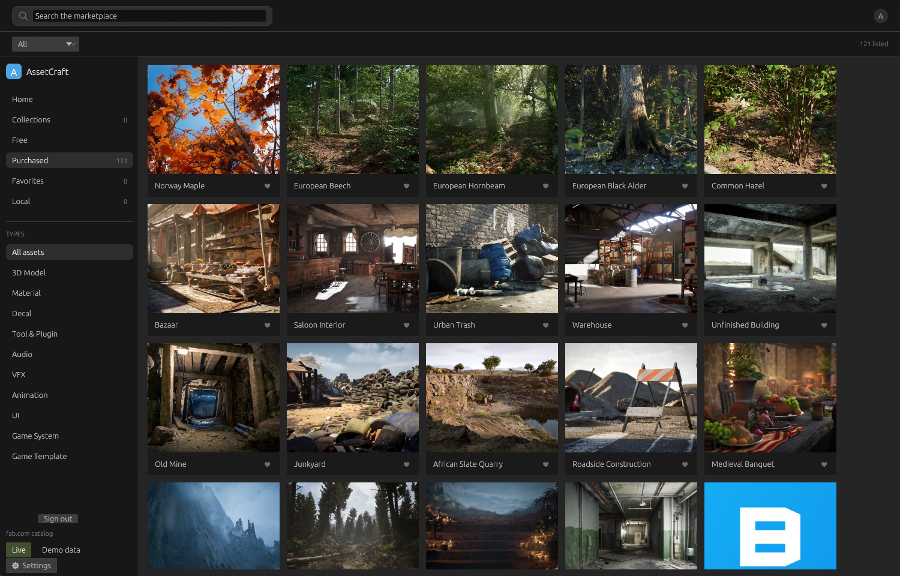
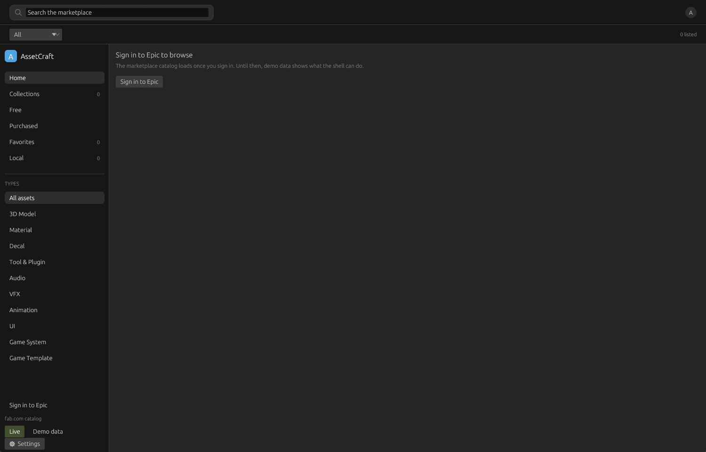
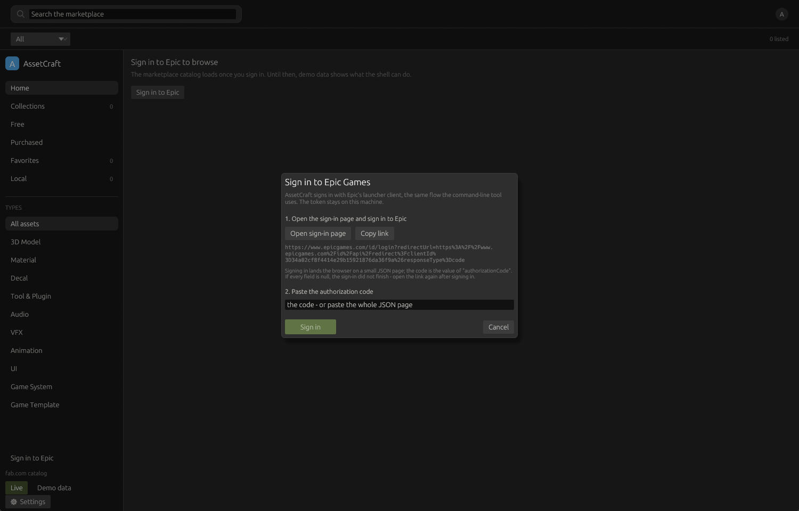
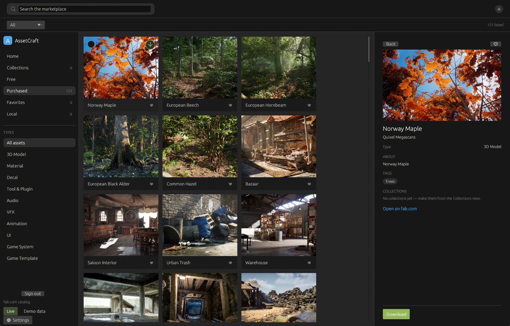

# AssetCraft

[](https://github.com/cmspeedau/AssetCraft/actions/workflows/ci.yml)
[](https://www.rust-lang.org/)
[](#installation)
[](LICENSE-MIT)



A cross-platform, open-source asset browser, downloader, and DCC exporter for
Megascans / Fab PBR assets — written in Rust.

AssetCraft is a ground-up reimplementation of the [Quixel Bridge](https://quixel.com/)
desktop app: browse and search a photogrammetry asset library, download the
quality tier and file formats you need, and push finished materials straight into
your content-creation tools. It is built for speed, a small footprint, and clean
cross-platform behavior on Windows, macOS, and Linux.

> **Status: pre-alpha.** The workspace builds, the CLI can search the Fab
> catalog, sign in, download an owned asset, and export it to Blender, a first
> egui desktop app is in-tree (no installers yet), and CI runs on Linux,
> macOS, and Windows. See [ROADMAP.md](ROADMAP.md) for what lands next, or
> jump to [Building from source](#building-from-source) to try the CLI.

---

## Disclaimer

AssetCraft is an **unofficial, community project**. It is not affiliated with,
endorsed by, or supported by Epic Games, Quixel, or Fab.

- Assets are served by **Fab**, Epic's marketplace. AssetCraft talks to Fab's
  official APIs using **your own** Epic/Fab account; it does not ship, resell, or
  redistribute any asset, and it cannot grant you access to content you have not
  licensed.
- You are responsible for complying with the [Fab Terms of Service](https://www.fab.com/)
  and the license attached to each asset you download.
- The original **Quixel Bridge** application is deprecated; Fab is now the
  supported source for Megascans content. AssetCraft targets Fab first.

---

## Table of contents

- [The promises](#the-promises)
- [Features](#features)
- [Architecture](#architecture)
- [Installation](#installation)
- [Onboarding](#onboarding)
- [Quick start](#quick-start)
- [Configuration](#configuration)
- [Supported DCCs](#supported-dccs)
- [Building from source](#building-from-source)
- [Project layout](#project-layout)
- [Contributing](#contributing)
- [License](#license)
- [Acknowledgements](#acknowledgements)

---

## The promises

Two of AssetCraft's milestone definitions of done are really product
promises — they are written here because they shape every feature and every
integration:

- **Offline-first.** *With the network disabled, previously downloaded assets
  are fully browsable and re-exportable.* Everything already on disk stays
  usable; the only action that needs a connection is fetching bytes you do
  not have yet.
- **No terminal required.** *A non-developer can install AssetCraft, sign in,
  download an asset, and export it into their DCC* — end to end, from the
  desktop app.

That is the contract every DCC integration ships against — Blender and Godot
today, whatever else lands: `export` reads the files the library
recorded, with the network off, and the desktop app drives sign-in, download,
and export so the terminal stays closed. An integration that misses either
half is not finished. See [ROADMAP.md](ROADMAP.md) for what works today and
what is still landing.

---

## Features

Target surface for `v1.0`. Much of it is in; [ROADMAP.md](ROADMAP.md) tracks
what already works and what is still landing.

### Catalog

- Search and filter the Fab/Megascans library by category, tags, type, and
  resolution.
- Rich asset detail: preview thumbnails, license, and download options, plus the
  texture maps and levels of detail an asset's files name — from its manifest
  before anything is fetched, or from the files already on disk with the network
  off.
- Offline browsing of the metadata you have already cached.

### Downloads

- Concurrent, **resumable** downloads with retry and backoff.
- Selectable quality tiers and file formats per asset.
- Checksum verification and integrity checks on every completed download.
- Reassemble Fab's chunked artifacts and verify each output file against its SHA-1.
- Bandwidth limits and a persistent download queue.

### Library

- Local SQLite index of everything you own, independent of the app that fetched it.
- Deduplication by asset ID, with re-download and re-export from the library.
- Favorites and named collections, kept in the library: the app organises the
  assets you hold, and the same notes are there next launch.
- Thumbnail and preview cache for fast, offline browsing.

### Integrations

- Standardized PBR folder layout (base color, normal, roughness, AO, etc.).
- One-click export to DCC tools, starting with **Blender** and **Godot**.
- Re-export of anything already downloaded, with the network off — export
  reads the files the library recorded, never Fab.
- A headless CLI for scripted and CI workflows.

### App

- A fast, native **egui** desktop UI with a small install footprint.
- Cross-platform builds for Windows, macOS, and Linux.
- A Collections view for the local library: named groups, opened like a folder,
  with membership edited from the asset detail panel.
- A Settings dialog over the same `settings.toml` the CLI reads.
- Auto-update: at startup the app asks its GitHub Releases feed for a newer
  build and, if one carries a verified checksum for this platform, offers it
  in a banner — download, SHA-256 check against the release's own digest,
  in-place swap, and a restart button. Opt out in Settings, or run
  `assetcraft update` from the CLI.

See [ROADMAP.md](ROADMAP.md) for the order in which these ship.

---

## Architecture

AssetCraft is a Cargo workspace of small, focused crates. The core and service
crates are GUI-agnostic, so the same engine powers both the desktop app and the
headless CLI.

| Crate | Kind | Responsibility |
| --- | --- | --- |
| `assetcraft-core` | lib | Domain model, traits, configuration, and error types. |
| `assetcraft-auth` | lib | Epic/Fab OAuth device flow and secure token storage (OS keyring). |
| `assetcraft-catalog` | lib | Fab API client: search, filters, metadata, and response cache. |
| `assetcraft-download` | lib | Concurrent, resumable download engine with integrity checks, manifest and chunk parsing, and reassembly. |
| `assetcraft-transfer` | lib | Resolves an owned asset and brings it down: formats → signed download info → manifest → chunks → verified files. |
| `assetcraft-library` | lib | Local SQLite library index, thumbnails, dedup, offline browse. |
| `assetcraft-dcc-blender` | adapter | Blender exporter and Python addon bridge. |
| `assetcraft-dcc-godot` | adapter | Godot exporter and GDScript plugin bridge. |
| `assetcraft-update` | lib | Auto-update: release feed, checksum-verified download, in-place binary swap. |
| `assetcraft-cli` | bin | Headless binary for scripted / CI workflows. |
| `assetcraft-gui` | bin | egui desktop app: browse, search, filter, download, and browse the local library. |

Dependency direction is one-way: binaries depend on the service and core crates,
never the reverse. DCC adapters are pure over local files: they read the source
the library recorded and write the layout and the generated script, and they
never touch the network — fetching is the transfer layer's job. That is what
makes [the promises](#the-promises) structural rather than per-plugin effort,
and what lets new integrations be additive; the shared export trait that
formalizes the shape lands with the second adapter (roadmap M6).

Detailed diagrams and design notes — including the plugin contract behind
[the promises](#the-promises) — live in [docs/architecture.md](docs/architecture.md).

---

## Installation

### Installers

The [Releases](https://github.com/cmspeedau/AssetCraft/releases) page carries
an installer for each platform, built from the same CI as everything else:

| Platform | Artifact | What it gives you |
| --- | --- | --- |
| Windows (x86_64) | `AssetCraft-<version>-windows-x86_64.msi`, or a portable `.zip` | both binaries in one folder; the MSI adds a Start-menu entry |
| macOS (universal) | `AssetCraft-<version>-universal.dmg` | AssetCraft.app (Apple Silicon + Intel) plus the `assetcraft` command |
| Linux (x86_64) | `assetcraft_<version>_amd64.deb` or `AssetCraft-<version>-x86_64.AppImage` | both binaries, a menu entry, and an icon |

Whichever way you install, the app keeps itself current against the same
Releases page — in the GUI, or with `assetcraft update` on the CLI. The
AppImage carries zsync update information too: its companion
`AssetCraft-<version>-x86_64.AppImage.zsync` lets any zsync-capable
updater (or `zsync` itself) move it to the latest release with a delta
download.

### Raw binaries

The release also carries the plain binaries — the same files the
auto-updater swaps in-place — for a `PATH` folder or a headless box:

| Platform | Binaries |
| --- | --- |
| Windows | `assetcraft.exe`, `assetcraft-gui.exe` (x86_64) |
| macOS | Apple Silicon and Intel builds of both |
| Linux | x86_64 builds of both |

The Blender addon and the Godot plugin are built from the repository for now
(`python3 blender_addon/package.py`, then *Install* it in Blender; see
[blender_addon/README.md](blender_addon/README.md) — and
`python3 godot_plugin/package.py` for Godot, see
[godot_plugin/README.md](godot_plugin/README.md)).

### From source

Requires a recent stable Rust toolchain (see [Building from source](#building-from-source)):

```bash
git clone https://github.com/cmspeedau/AssetCraft.git assetcraft
cd assetcraft
cargo install --path crates/assetcraft-cli
```

---

## Onboarding

The desktop app takes you from an empty window to an asset in your DCC without a
terminal. Here is the whole path, end to end.

### 1. Open the app: an empty store until you sign in

AssetCraft opens on a signed-out window. Nothing is fetched and the marketplace
views stay empty until you sign in — the same clean first run as Quixel Bridge.
The Local and Collections views work regardless: they only ever read what is
already on your disk, and the offline demo catalog is one toggle away in the
sidebar if you just want to see the shell move.



### 2. Sign in with your Epic launcher session

AssetCraft signs in through Epic's launcher credentials, the same flow the CLI's
`assetcraft login` uses: open Epic's login page, sign in there, then paste the
authorization code (or the whole JSON page Epic lands on) back into the dialog.
The token goes into your OS keyring and stays on your machine — AssetCraft never
sees your password, and it can only reach assets your account already owns.



### 3. Browse your Purchased library

Signed in, **Purchased** lists the Fab library your account owns — paging through
it in the background, thumbnails and all. This is where downloads start: Fab only
delivers the artifact of an asset you own, so the download action lives here
rather than on a search-result card. (A catalog card the account does own offers
an "Open in Purchased" jump to the same asset.) Local counts what is on disk, so
it reads `0` until you have downloaded something — the sync that fills the
background index is not the same as files you hold.


### 4. Download, then export to Blender

Select a card and its detail panel opens with an enabled **Download** button.
AssetCraft resolves the newest engine build Fab will deliver, fetches and
reassembles its chunks, verifies every file, and records where it landed. Once
the files are on disk the same panel offers **Export to Blender** — it lays out
the PBR maps and writes the import script from the recorded files, with the
network off, and hands it to Blender. That is the full DoD path: install, sign
in, download, export, terminal closed.



> The app is in-tree but not yet packaged — see [Installation](#installation) for
> building from source, and [ROADMAP.md](ROADMAP.md) for installers and
> auto-update.

---

## Quick start

Working today:

```bash
# Sign in to your Epic/Fab account (opens a browser for an authorization code)
assetcraft login

# Browse the catalog without signing in
assetcraft search "rock cliff" --type surface --limit 20
assetcraft taxonomy licenses
assetcraft taxonomy tags

# Inspect an asset's formats, and pick the file you want
assetcraft formats <asset-id>
assetcraft formats <asset-id> --format fbx --quality 4K --prefer largest

# Describe what an asset contains: its texture maps by material, its meshes by
# level of detail. By default this reads Fab's manifest, which names every file
# before a single byte is fetched (requires sign-in); --offline reads the files
# `download` left on disk, and --source reads a directory you name.
assetcraft structure <asset-id> --format fbx
assetcraft structure <asset-id> --offline
assetcraft structure <asset-id> --source ./Downloads --json

# Resolve an owned asset into the chunks and files to fetch (requires sign-in)
assetcraft resolve <asset-id> --format fbx --quality 4K --chunks

# Download and reassemble it, verifying every file (requires sign-in).
# The CDN base the chunk paths hang off is taken from the manifest URL in the
# signed download-info response; pass --chunk-base to override it, and --output
# to write somewhere other than the standard asset directory.
assetcraft download <asset-id> --format fbx --quality 4K \
  --output ./Downloads --chunk-base https://cdn.example.com/CloudDir

# Sync the assets you own into the local library (requires sign-in)
assetcraft library

# Browse it offline, search it, or check it for damage
assetcraft library --offline
assetcraft library --search "rock"
assetcraft library --verify

# Cache thumbnails so the library browses offline
assetcraft library --thumbnails

# Re-download straight from the library: with no flags, the asset comes back
# down to the location the library recorded for it (requires sign-in).
assetcraft download <asset-id>

# Lay a downloaded asset out as a Blender PBR material and write an import
# script. `download` records where the files landed, so with no --source the
# export resolves them from the library and works with the network off; pass
# --source to export a directory directly, or --run to hand the script to a
# detected Blender.
assetcraft export <asset-id> --target ./MyProject
assetcraft export <asset-id> --source ./Downloads --format fbx --run

# From inside Blender, no terminal needed: package the addon, install the zip,
# point its "Export Library" preference at the --target folder, and import
# from the viewport sidebar (N). The addon runs the export's own script.
python3 blender_addon/package.py    # -> blender_addon/dist/assetcraft_blender.zip

# Godot: same layout, re-expressed as GDScript + a .tscn scene, with the
# occlusion/roughness/metallic maps packed into one ORM texture and glTF
# preferred when the asset has it. --run imports project files then runs the scene.
assetcraft export <asset-id> --dcc godot --target ./MyGame
python3 godot_plugin/package.py     # -> godot_plugin/dist/assetcraft_godot.zip

# Fetch a single file, resuming and verifying as it goes
assetcraft fetch https://example.com/asset.zip --output asset.zip --sha256 <hash>

# Cap the download rate (bytes per second; `k`/`M` suffixes are accepted)
assetcraft fetch https://example.com/asset.zip --output asset.zip --limit 2M

# Launch the desktop app (`--demo` uses the offline catalog)
assetcraft-gui
```

---

## Configuration

AssetCraft follows platform conventions for config, cache, and data directories
(via the `directories`-style project paths):

| Path | Contents |
| --- | --- |
| Config | `settings.toml` (below) and other configuration files. |
| Cache | API response cache, thumbnails, partial downloads, staged updates. |
| Data | Local library index (SQLite: owned assets, download records, favourites, collections) and downloaded assets. |
| Tokens | OAuth credentials, in the OS keyring where one answers; otherwise an owner-only private file, never world-readable. |

`settings.toml` holds the user's own choices, in plain TOML. Every key is
optional — the file describes departures from the defaults, and a missing file
is simply the defaults. A file that exists but cannot be read is reported, not
quietly worked around.

```toml
# The quality tier the download picker starts on, as `--quality` words it.
# Leave unset to take whatever quality the asset's first file offers.
default_quality = "4K"

# Root for downloads: one directory per asset id under this one.
# Leave unset for the standard asset directory under the data directory.
download_dir = "/media/assets"

# Ask the release feed for a newer version when the app starts (default: yes).
# Nothing ever installs without the banner's Update button.
auto_update = true
```

Both binaries read the file at the point of use, so an edit takes effect on the
next download with nothing restarted: the app's Settings dialog is a front end
for this same file, and `assetcraft download` obeys both keys while `--output`
and `--quality` still outrank them.

---

## Supported DCCs

| Tool | Status |
| --- | --- |
| Blender | CLI export works (`assetcraft export`): standard PBR layout + generated import script + machine-readable manifest. In-editor addon (`blender_addon/`) for one-click import from the viewport sidebar. The desktop app's local library drives the same export: one **Export to Blender** button, and the addon browses the app's export folder by default. Any packaging works — Flatpak (`org.blender.Blender`) and Snap included: detection finds the Flatpak export wrapper, and the addon resolves the app's export folder through the sandbox. |
| Plain folder export | Available (the layout `export` writes) |
| Godot | CLI export works (`assetcraft export --dcc godot`): the same PBR layout, a generated GDScript that builds `StandardMaterial3D`/`ORMMaterial3D` materials (AO/roughness/metallic packed into one ORM texture), and a `.tscn` scene that opens in Godot 4. glTF is preferred when the asset has it. In-editor plugin (`godot_plugin/`) for one-click import from a dock. Detection finds Godot on Linux (package, Snap, Flatpak), macOS, and Windows, and `--run` imports project files then runs the scene headlessly. |
| Misty Engine | Planned (roadmap M7): glTF/OBJ meshes, Standard-shader material and prefab written into the project's `Assets/` tree with GUID-stable `.meta` sidecars. |
| Unreal Engine | Under consideration |
| Maya | Under consideration |
| Houdini | Under consideration |
| Unity | Under consideration |

An integration joins this list when it meets [the promises](#the-promises):
export from the library with the network off, and a path the desktop app can
drive end to end without a terminal.

Want a DCC on this list? Open an issue describing your workflow.

---

## Building from source

### Prerequisites

- **Rust**: stable toolchain via [rustup](https://rustup.rs/). The pinned
  `rust-toolchain.toml` selects the channel and the `rustfmt`/`clippy`
  components automatically.
- **Git**.

TLS uses the platform's native stack (OpenSSL on Linux, Schannel on Windows,
Secure Transport on macOS), so on Linux you also need the OpenSSL development
headers (`libssl-dev` on Debian/Ubuntu).

Platform-specific tooling for a native egui window (M5) and packaging will be
documented per-OS as it is wired up.

### Build

```bash
cargo build --workspace            # debug
cargo build --workspace --release  # optimized
cargo test --workspace             # run tests
cargo clippy --workspace -- -D warnings
```

---

## Project layout

```text
assetcraft/
├── Cargo.toml              # workspace manifest
├── crates/
│   ├── assetcraft-core/        # domain model, asset structure, config, errors
│   ├── assetcraft-auth/        # Fab OAuth + token storage
│   ├── assetcraft-catalog/     # Fab API client + metadata cache
│   ├── assetcraft-download/    # download engine
│   ├── assetcraft-transfer/    # resolve + download + assemble one asset
│   ├── assetcraft-library/     # local library index
│   ├── assetcraft-dcc-blender/ # Blender exporter
│   ├── assetcraft-dcc-godot/   # Godot exporter
│   ├── assetcraft-cli/         # headless binary
│   └── assetcraft-gui/         # egui desktop app
├── blender_addon/          # in-Blender addon (Python) and its tests
├── godot_plugin/           # in-Godot editor plugin (GDScript) and its tests
├── docs/                   # architecture and design notes
├── ROADMAP.md
└── README.md
```

---

## Contributing

Contributions are welcome. See the [roadmap](ROADMAP.md) for where the project
is and what is next.

Before opening a pull request:

1. Run `cargo fmt --all`.
2. Run `cargo clippy --workspace --all-targets -- -D warnings`.
3. Run `cargo test --workspace`.
4. Keep changes focused and match the surrounding style.

For larger features — especially new DCC integrations — open an issue to discuss
the approach first. Roadmap items are tracked in [ROADMAP.md](ROADMAP.md); feel
free to propose changes to it.

---

## License

Licensed under either of

- Apache License, Version 2.0 ([LICENSE-APACHE](LICENSE-APACHE))
- MIT license ([LICENSE-MIT](LICENSE-MIT))

at your option.

Unless you explicitly state otherwise, any contribution intentionally submitted
for inclusion in this project by you, as defined in the Apache-2.0 license, shall
be dual-licensed as above, without any additional terms or conditions.

---

## Acknowledgements

- **Epic Games / Quixel / Fab** for the Megascans library and the marketplace
  APIs this project builds against.
- The **Rust** ecosystem: [egui](https://github.com/emilk/egui),
  [reqwest](https://github.com/seanmonstar/reqwest),
  [tokio](https://github.com/tokio-rs/tokio),
  [sqlx](https://github.com/launchbadge/sqlx), and the many crates this project
  depends on.
